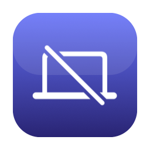

# ClamOpen 开盖合盖

<p align="center">
  
  &nbsp;&nbsp;&nbsp;
  
</p>

<p align="center">
  <b>外接显示器在线时，盖子开着也只用外接屏</b><br>
  —— 等效合盖，但无需真的合上盖子。
</p>

<p align="center">
  <a href="README.md">English</a> · <a href="README.zh-CN.md">简体中文</a>
</p>

---

ClamOpen 是一个常驻菜单栏的小工具：在连接外接显示器时，**真正关闭 MacBook 内置屏**（背光熄灭、停止渲染），而**盖子保持打开**。效果等同合盖（clamshell），但你仍能用摄像头、Touch ID、键盘，散热也更好。

## 为什么需要它

macOS 只在**合盖**时才关闭内置屏。如果你想开着盖子（为了摄像头、Touch ID、内置键盘，或单纯散热），系统没有原生开关。ClamOpen 就是这个开关。

## 功能

- 🖥️ 菜单栏一键开 / 关内置屏
- 🤖 **自动模式** —— 接外接屏自动关内置、拔掉自动恢复
- 🔋 **电源管理** —— 一键优化休眠设置，防止夜间频繁唤醒耗电（禁用 TCP Keep Alive、网络唤醒等）
- 🎛️ **显卡管理** —— 查看主显示器当前 GPU、电池／插电显卡策略；在支持的 Intel 双显卡 Mac 上主动选择独显优先或自动切换
- 🧩 **应用显卡管理** —— 通用应用列表；Chrome / Arc / ego lite 启动偏好，Electron 桌面应用实验性高性能请求，原生／未知应用只读
- 🛟 **独立急救恢复** ——「恢复内置屏」App 不依赖主程序；主程序还提供 `⌃⌥⌘R` 全局恢复快捷键
- 🔒 **安全优先** —— 没有外接屏时拒绝关闭内置屏；拔线 / 退出自动恢复
- 🪶 仅菜单栏（无 Dock 图标）、无后台守护进程；显示配置仅当前会话有效（电源管理选项会持久修改 pmset）

## 实现原理

ClamOpen 通过 **CoreGraphics / SkyLight 的私有符号**关闭内置屏：

```c
CGError CGSConfigureDisplayEnabled(CGDisplayConfigRef config, CGDirectDisplayID display, bool enabled);
```

放在标准的显示器重配置事务里调用：

```swift
var config: CGDisplayConfigRef?
CGBeginDisplayConfiguration(&config)
CGSConfigureDisplayEnabled(config, builtinDisplayID, false)   // false = 禁用
CGCompleteDisplayConfiguration(config, .forSession)
```

- `CGBeginDisplayConfiguration` / `CGCompleteDisplayConfiguration` 是**公开**的 CoreGraphics 接口。
- `CGSConfigureDisplayEnabled` 是真正干活的**私有**符号。通过
  `dlsym(RTLD_DEFAULT, "CGSConfigureDisplayEnabled")` 在运行时取得（它就在 CoreGraphics / SkyLight
  内），因此**不需要链接私有框架**，也不需要任何 entitlement。
- 之后内置屏的 `CGDisplayIsActive == false`：背光关闭、不再渲染 —— 视觉上和合盖一致，但盖子开着。
- `forSession` 作用域表示设置只在**当前登录会话**有效；因此**注销或重启一定会恢复内置屏**。

这与 [Lunar](https://lunar.fyi)、[BetterDisplay](https://github.com/waydabber/BetterDisplay) 等工具
用的是同一套底层机制。（Apple Silicon 上还有更彻底的“软断开”能释放 framebuffer；ClamOpen 用的
`CGSConfigureDisplayEnabled` 路径在 Intel 与 Apple Silicon 上都可用。）

> 已在 macOS 26.5.1（Intel）实测：禁用返回 `CGError 0`，内置屏变为非活动；重新启用后恢复正常。

## 安全与恢复

### v1.1.1：唤醒安全模式与主动恢复自动关屏

- 只有外接屏同时满足 **online、active、非 asleep**，才允许关闭内置屏；这仍不能保证外接面板物理上确实显示了画面。
- 监听系统与显示器睡眠／唤醒。休眠期间暂停配置；只有系统唤醒但没有屏幕唤醒证据时继续等待，避免后台维护唤醒（DarkWake）被误当成正常唤醒。
- 唤醒、手动恢复、独立急救或发现内置屏被重新启用后，进入**安全模式**：保持内置屏开启，自动模式和看门狗不会把它重新关掉。
- 想再次只用外接屏，主动点击「关闭内置屏（只用外接）」，或**主动开启自动模式**。外接屏可用、没有正在恢复或新急救请求时，立即解除安全暂停并关闭内置屏；启动时读取自动模式偏好不会解除安全模式。
- 自动模式已勾选但被安全暂停时，菜单会显示「自动：已暂停（关闭后重新开启可恢复）」。关闭后再次开启即可明确恢复自动关屏。没有可用外接屏时只记录自动模式偏好，不强行关屏，也不清除安全暂停。
- 显示重配置回调、AppKit 屏幕通知和约 1 秒轮询共用同一状态机。
- 恢复最多提交 4 次配置（正常调度下约第 0、1、3、7 秒）；之后继续读取状态，不无限重试。只有后续快照确认内置屏 active 且非 asleep 才报告恢复成功。失败会显示菜单状态并记录日志，可再次急救。
- 退出时也尝试恢复并验证，等待有上限；强制结束进程无法执行退出恢复。

独立恢复工具先原子写入带 UUID 的恢复请求，再启用内置屏。主程序通过通知和轮询接收请求；解除安全模式只确认已经处理的 UUID，不删除后来到达的急救请求。标记保存在 `~/Library/Application Support/ClamOpen/`，重启 App 后仍有效。

### 万一屏幕全黑

1. **按 `Control + Option + Command + R`（`⌃⌥⌘R`）**：主程序运行时触发紧急恢复，不依赖 Spotlight。若快捷键注册失败，菜单会提示；锁屏／登录界面不保证可用。
2. **Spotlight 盲打**：按 `⌘ 空格`，输入「恢复内置屏」，回车。独立工具不依赖主程序运行，也不会再被新版主程序重新关回。
3. **拔掉外接显示器**，让正在运行的主程序尝试恢复内置屏。
4. 必要时合盖再开盖，或注销／重启，重新建立显示会话。

这些是恢复尝试，不是对系统／GPU 硬死机的保证。私有接口失效或物理面板没有画面时，软件状态也可能不足以判断。

### 诊断与测试

```bash
swift test                          # 模拟显示器状态，不开关真实屏幕
./scripts/diagnose_wake.sh > ~/clamopen-wake.txt
```

诊断脚本只读取系统版本、pmset 设置、近期睡眠／唤醒记录、显示器状态和 ClamOpen 日志，不修改配置。日志可能包含设备／进程信息，分享前请检查。

人工验收（保存工作后自行进行）：

- 自动模式关闭和开启时，分别测试长时间显示器休眠／整机睡眠后唤醒：内置屏应恢复并保持开启。
- 内置屏关闭时，分别测试快捷键和独立恢复 App：等待至少 10 秒，应不再被看门狗关回。
- 反复睡眠／唤醒、拔插外接、退出／重启主程序：验证安全模式和退出恢复。
- 检查夜间日志，不应因轮询产生持续 enable 配置；仅后台系统唤醒且无显示器唤醒证据时应等待。
- 锁屏、隔夜、扩展坞重连需要实机验证；自动化测试不代替这些场景。

## 从源码构建

要求：macOS 12+，Xcode / Swift 5.9+。

```bash
git clone https://github.com/Attiv/clamOpen.git
cd clamOpen
./build_app.sh        # 生成图标、编译并打包两个 App
```

产物：

- `ClamOpen.app` —— 菜单栏主程序
- `恢复内置屏.app` —— 独立急救恢复程序

或仅编译：`swift build -c release`

## 安装

把 **`ClamOpen.app`** 和 **`恢复内置屏.app`** 都拖进 `/Applications`。急救 App 放进去后，Spotlight
才能在全黑时被你盲打搜到（强烈建议）。首次运行若被 Gatekeeper 拦截（本地 ad-hoc 签名），右键点
App →「打开」即可。

**升级时先退出旧版主程序，确认内置屏恢复，再同时替换两个 App 并重新打开主程序。** v1.0 不识别恢复标记，不能与新版恢复工具混用来验证防重关行为。

开机自启：系统设置 → 通用 → 登录项 → 添加 `ClamOpen.app`。

## 使用

### 显示器控制

1. 接上外接显示器。
2. 点菜单栏图标 →「关闭内置屏（只用外接）」。
3. 想恢复 →「紧急恢复内置屏」，或按 `⌃⌥⌘R`。唤醒／急救后自动关屏会安全暂停；主动重新开启自动模式可在安全检查通过后立即恢复关屏。

### 电源管理（防止夜间耗电）

**问题症状**：MacBook 晚上休眠一晚，第二天早上电池耗尽。

**原因**：macOS 默认启用 TCP Keep Alive，导致系统在休眠时每分钟唤醒一次维护网络连接，造成电池快速耗尽。

**解决方法**：

1. 点菜单栏图标 → 「电源管理」（如果检测到耗电问题会显示 ⚠️ 标记）
2. 查看当前电源设置
3. 点击「应用省电设置」，输入管理员密码
4. 完成后，系统会禁用以下功能：
   - TCP 保活（防止频繁唤醒）
   - 网络唤醒
   - 靠近唤醒
   - 调整待机延迟为 1 小时

**不影响正常使用**：打开盖子、按键盘、点触控板等正常唤醒方式完全不受影响。

**验证效果**：第二天早上打开终端运行：
```bash
pmset -g log | grep -E "DarkWake" | tail -20
```
查看夜间唤醒次数是否明显减少。

### 显卡管理（v1.2）

菜单直接显示 **「主显示器当前 GPU」**；展开「显卡管理」可查看电池与插电模式的
`gpuswitch` 策略，选择「使用独立显卡」或「恢复自动切换」，也可以手动刷新状态。

- GPU 名称来自 `CGDirectDisplayCopyCurrentMetalDevice(CGMainDisplayID())`，表示**当前驱动主显示器的 GPU**，不是所有应用的实际渲染设备。
- 不使用 `MTLCreateSystemDefaultDevice()` 作为状态探针：Apple SDK 明确说明，在自动切换显卡的 Mac 上，该调用本身可能激活高性能 GPU。设备枚举使用不会主动切卡的 `MTLCopyAllDevices()`。
- 两个切换操作分别以一次系统管理员认证执行 `pmset -a gpuswitch 1`（独显优先）或 `2`（自动）；**同时作用于电池和插电模式，并持久保存**。独显可能增加耗电与发热。
- 操作完成后重新读取两种供电模式，只有都与目标一致才报告「策略已更新」。主屏 GPU 单独显示；开启自动切换后，接着外屏时主屏仍可能由 AMD 驱动。
- 查看和认证在后台串行执行，不阻塞屏幕恢复看门狗。睡眠、恢复或退出时会取消待处理的切换请求；授权后的命令还检查请求标记与主进程存活，避免迟到的授权继续应用设置。已完成的写入不会因取消而自动回滚。
- 单显卡、Apple Silicon、无法识别策略等场景只显示状态，不提供切换。不提供强制核显选项。
- 启动、打开菜单、刷新、唤醒都不会自动写入显卡策略。退出或卸载 App 也不会自动恢复持久策略；需要恢复时主动选择「恢复自动切换」。

**浏览器限制：** Chromium 应用可以自行选择 GPU；系统策略和主屏 GPU 不证明 Chrome、Arc 或 ego lite 已切换。
浏览器实际渲染设备仍应查看 `chrome://gpu` 的 `GL_RENDERER`，必要时以独显参数重启浏览器。

自动化测试只使用模拟 GPU 后端及无害的子进程取消测试，不切换真实 GPU、不弹管理员认证。
更新安装后的人工验收：

1. 打开菜单，核对主屏 GPU，以及电池／插电两行；打开、刷新菜单不应出现认证框。
2. 取消一次切换认证，不应报告成功；认证等待期间确认紧急恢复快捷键仍可用。
3. 保存工作后主动切换策略，用 `pmset -g custom` 确认两个 `gpuswitch` 值；完成后按需要恢复独显优先。
4. 在安全条件下验证睡眠、急救或退出会撤销尚未完成的请求，不应在稍后认证后继续写入。

### 应用显卡管理（v1.3）

入口：菜单栏 → **显卡管理 → 应用显卡管理…**。支持搜索、按运行状态／能力筛选、手动刷新，以及添加标准目录之外的 `.app`。扫描 `/Applications`、`~/Applications`、`/System/Applications` 和运行中的应用；以应用实际路径区分副本，不用 bundle ID 合并。

| 能力 | 行为 |
| --- | --- |
| 可设置（Chrome / Arc / ego lite） | 默认或优先高性能 GPU（本机 AMD） |
| 实验性（检测到 Electron Framework） | 可保存并尝试高性能请求；首次保存需确认，效果尚未逐应用验证 |
| 仅查看（原生／未知应用） | 可查看路径、运行状态与可读的启动参数；不能强制逐应用选卡 |

- **偏好只对本窗口的「按已保存偏好启动」生效**。不会更改原 Dock／Finder／文件关联入口，也不改变此前创建的独显启动器。默认＝不附加参数，**不是强制 Intel**。
- 高性能请求仅传入 `--force-high-performance-gpu`；Electron 应用可能忽略或覆盖参数。保存不会启动／退出应用；启动前检测同路径或同 bundle ID 的运行实例，请先自行完全退出。没有强制集显、热切换、后台自动重启或启动守护。
- 「主进程启动参数」只说明可读取的外部参数。应用内部可能另外配置选卡；参数存在或不存在都不能证明实际渲染 GPU。进程退出／权限不足显示未知。只读取所选应用 PID，不保存或记录完整命令行及环境变量。
- 实际渲染 GPU 默认显示 **未知**。可以从浏览器 `chrome://gpu` 下载文本报告，或导入其他包含 `GL_RENDERER` 的 UTF-8 文本报告（最大 2 MB）。报告归属由用户指定，不自动核验来自哪个应用；仅显示其中的渲染器和导入时间，明确标注 **非实时**，不代表全部渲染上下文。
- 偏好位于 `~/Library/Application Support/ClamOpen/application-gpu.json`，原子保存；格式损坏／版本未知时禁用保存和按偏好启动，不覆盖原文件。历史报告仅保留在当前进程内存中。没有修改 `.app` 签名、浏览器配置、系统显卡策略或 Dock。
- 扫描／读写／参数查询在后台；主线程只更新缓存 UI。睡眠、显示器拓扑变化、急救、恢复或退出会取消尚未提交的启动意图；已提交的启动不能回滚，也不会假装已取消。

验证：`swift test`；在已登录的 macOS GUI 会话中运行 `bash scripts/test_application_gpu_window.sh`，仅创建临时假应用、临时偏好和假启动器，渲染新窗口；不运行原 AppDelegate、不启动真实应用、不写 pmset。

人工验收：
1. 打开窗口、搜索／筛选／刷新；不应出现管理员认证或启动其他应用。
2. 选原生应用，高性能选项不可用；选 Electron 应用首次保存高性能应弹实验性确认。保存前后原应用不变、不会自动退出。
3. 保持目标应用运行，启动按钮不可用；手动退出后保存并从窗口启动，再用目标应用自身诊断验证 GPU。
4. 通过原 Dock 直接启动不应被 ClamOpen 劫持。导入旧 Intel 报告应显示历史 Intel GL_RENDERER，而不是当前主屏 AMD；不能据此判断现在仍在用 Intel。

## 项目结构

```
Sources/ClamOpen/      菜单栏主程序
  ├── RecoveryHotKey.swift       全局急救快捷键
  ├── PowerManager.swift         电源管理（休眠优化）
  ├── AppDelegate.swift          应用主逻辑
  ├── ApplicationGPUWindowController.swift  独立应用显卡窗口
  └── main.swift
Sources/ClamCore/      两个 App 共用的控制与恢复逻辑
  ├── DisplayController.swift       显示器查询与私有接口调用
  ├── DisplaySafetyCoordinator.swift 睡眠／唤醒／恢复状态机
  ├── RecoveryLatch.swift           跨进程恢复请求与确认
  ├── RecoveryDiagnostics.swift     Unified Logging
  ├── GPUController.swift           被动主屏 GPU 查询、策略解析与可取消的认证写入
  ├── ApplicationGPU.swift          应用清单、能力、偏好、启动约束与报告解析
  └── ApplicationGPUBackend.swift   原生启动、所选进程参数查询
Sources/ClamRestore/   独立急救恢复工具
Tests/ClamCoreTests/   无硬件操作的回归测试
make_icon.swift        程序化图标生成
build_app.sh           构建并打包两个 .app
Info*.plist            Bundle 元数据
scripts/               开发 / 验证脚本（探针、开关测试、禁用）
```

## 兼容性

- 原有开关接口曾实测：macOS 26.5.1，Intel（UHD 630 + Radeon Pro 5500M）。
- v1.3 的构建、模拟状态、应用显卡窗口与显卡策略测试在 macOS 26.7.1 Intel 验证；真实隔夜休眠、锁屏恢复和显卡认证交互仍需人工验收。
- `CGSConfigureDisplayEnabled` 路径在 Intel 与 Apple Silicon 上均可用。
- 私有接口可能随系统更新变化；截至撰写在上述系统稳定可用。

## 免责声明

ClamOpen 使用了 Apple 私有接口。它不需要特殊 entitlement，显示配置仅当前会话有效（另行选择电源管理会持久修改系统电源设置），但私有接口不受 Apple 支持、可能随版本变化。请自行承担使用风险。

## 许可证

MIT —— 见 [LICENSE](LICENSE)。
